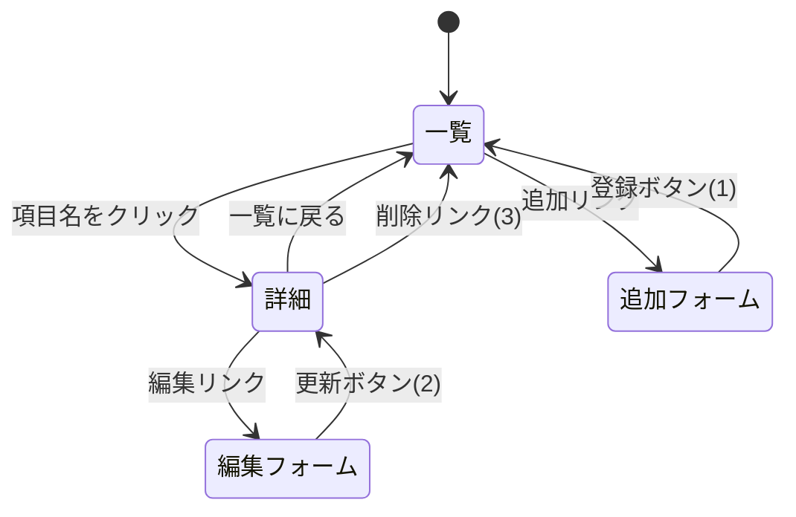

# レポート用Webアプリの設計案

京葉線システム以外に，一覧表示をベースとした以下の3つのWebアプリケーションを開発する．
データはサーバ（`app5.js` など）の変数内に記録する．
REST APIの詳細は次回以降の授業内容に合わせて修正する．

| No | システム名 | 対象 | URLの起点 |
|-|-|-|-|
| 1 | ゲーム管理システム | ゲームのタイトルと制作企業など | `/games` |
| 2 | バルファルク武器一覧システム | MHXXにおけるバルファルク素材の武器 | `/valfalk` |
| 3 | アニメ作品管理システム | アニメ作品の放送年や制作会社など | `/anime` |

## 共通の機能

どのシステムも以下の5つの機能を持つ．

| 機能 | メソッド | リソース名（予定） | 内容 |
|-|-|-|-|
| 一覧表示 | GET | `/xxx` | 全データの一覧を表示する |
| 詳細表示 | GET | `/xxx/:number` | 1件のデータの全項目を表示する |
| 追加 | GET / POST | `/xxx/create`，`/xxx` | 入力フォームを表示し，送信されたデータを追加する |
| 変更 | GET / POST | `/xxx/edit/:number`，`/xxx/update/:number` | 編集フォームを表示し，送信された内容でデータを書き換える |
| 削除 | GET | `/xxx/delete/:number` | 指定したデータを削除する |

※ `xxx` には `games`，`valfalk`，`anime` が入る．`:number` は配列の添字．

## 共通のページ遷移図

---

## 1. ゲーム管理システム

ゲームのタイトル，制作企業，ジャンル，発売年，対応機種を管理する．
（第8回で作成した `/games` を拡張する）

### スキーマ

| 項目名 | 型 | 内容 |
|-|-|-|
| id | 数値 | ゲームID |
| title | 文字列 | ゲーム名 |
| company | 文字列 | 制作企業 |
| genre | 文字列 | ジャンル |
| year | 数値 | 発売年 |
| platform | 文字列 | 対応機種 |

### ページ一覧

| ページ | リソース名 | テンプレート |
|-|-|-|
| 一覧 | `/games` | `views/games.ejs` |
| 詳細 | `/games/:number` | `views/games_detail.ejs` |
| 追加フォーム | `/games/create` | `views/games_new.ejs` |
| 編集フォーム | `/games/edit/:number` | `views/games_edit.ejs` |

### 一覧に表示する項目

ID，ゲーム名，制作企業

---

## 2. バルファルク武器一覧システム

モンスターハンターダブルクロス（MHXX）に登場する天彗龍バルファルクの素材から作られる武器を，
武器種ごとに管理する．

### スキーマ

| 項目名 | 型 | 内容 |
|-|-|-|
| id | 数値 | 武器ID |
| name | 文字列 | 武器名 |
| type | 文字列 | 武器種（大剣，太刀，片手剣など） |
| rarity | 数値 | レア度 |
| attack | 数値 | 攻撃力 |
| affinity | 数値 | 会心率（%） |
| element | 文字列 | 属性・状態異常（なしの場合は空文字） |
| slots | 数値 | スロット数 |

### ページ一覧

| ページ | リソース名 | テンプレート |
|-|-|-|
| 一覧 | `/valfalk` | `views/valfalk.ejs` |
| 詳細 | `/valfalk/:number` | `views/valfalk_detail.ejs` |
| 追加フォーム | `/valfalk/create` | `views/valfalk_new.ejs` |
| 編集フォーム | `/valfalk/edit/:number` | `views/valfalk_edit.ejs` |

### 一覧に表示する項目

ID，武器種，武器名，攻撃力

---

## 3. アニメ作品管理システム

アニメ作品のタイトル，制作会社，放送年，話数，ジャンルを管理する．

### スキーマ

| 項目名 | 型 | 内容 |
|-|-|-|
| id | 数値 | 作品ID |
| title | 文字列 | 作品名 |
| studio | 文字列 | 制作会社 |
| year | 数値 | 放送開始年 |
| episodes | 数値 | 話数 |
| genre | 文字列 | ジャンル |

### ページ一覧

| ページ | リソース名 | テンプレート |
|-|-|-|
| 一覧 | `/anime` | `views/anime.ejs` |
| 詳細 | `/anime/:number` | `views/anime_detail.ejs` |
| 追加フォーム | `/anime/create` | `views/anime_new.ejs` |
| 編集フォーム | `/anime/edit/:number` | `views/anime_edit.ejs` |

### 一覧に表示する項目

ID，作品名，放送開始年
